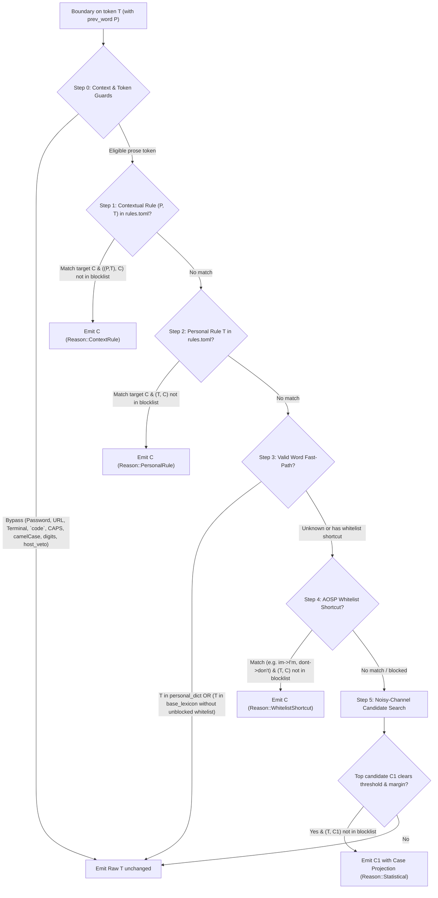
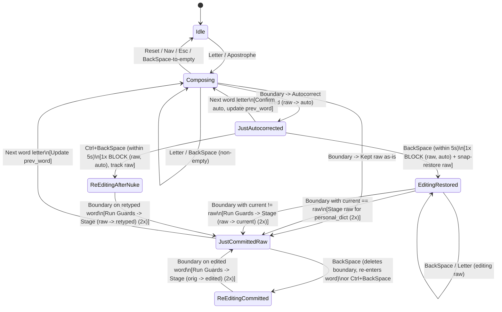

# SmartKey — Architecture & Implementation Plan (Approach #3)

> **Status:** Ready for Phase 1 implementation  
> **Companion doc:** [competitor-analysis.md](./competitor-analysis.md)  
> **Core Strategy:** Statistical noisy-channel English autocorrect (powered by AOSP `main_en_US.combined`) underneath a **guarded, deterministic, plain-text rule layer (`rules.toml`)** driven by a pure keystroke/edit state machine.

---

## 1. Core Architectural Principles

1. **Functional Core, Imperative Shell:**
   - `smartkey-core` is **100% pure, synchronous, single-threaded Rust** with zero OS, clock, thread, or IME framework dependencies.
   - Every transition has the signature `engine.handle_event(event: InputEvent, now_ms: u64) -> EngineOutput`. Passing `now_ms` explicitly makes time windows (such as the 5-second undo window) completely deterministic in unit tests without `sleep()`.
2. **Asymmetric Learning Thresholds (`1x` to Block, `2x` to Learn):**
   - **Negative signal (Undo):** Rejecting an autocorrection once (`1x`) writes a permanent **pair-level** block rule `(typed, rejected)` immediately. Never make the user undo the same bad fix twice.
   - **Positive signal (Manual edit or kept unknown word):** Staged in `learner_state.json` on the `1st` occurrence and promoted to `rules.toml` on the **`2nd` confirmation**, filtering out one-off fat-finger noise.
3. **Plain-Text Source of Truth (`Editing the file = Editing the brain`):**
   - Graduated rules live in `~/.config/smartkey/rules.toml` and are updated using **`toml_edit`** so user comments and formatting are preserved when new rules graduate.
   - High-churn counters (1-count staging candidates, bigrams, weekly slip stats) live separately in `~/.local/share/smartkey/learner_state.json` so background state never races with manual edits or Syncthing.
4. **Decoupled Host Topology (English Standalone First, Bilingual & Mobile Plug-In):**
   - **Repo 1 (`smartkey` — this repo):** Pure English/language-agnostic Rust core + CLI + standalone `fcitx5-smartkey` addon (which also exports `smartkey_public.h` via `FCITX_ADDON_DECLARE_FUNCTION`).
   - **Phase 2 (`fcitx5-lotus` bridge):** Optional integration calling `smartkey` for non-Vietnamese words + bilingual Telex collision shields.
   - **Phase 3 (`HeliBoard` Android):** Links the exact same `smartkey-core` via JNI (`cargo-ndk`).

---

## 2. Repository & Crate Layout

```text
smartkey/
├── Cargo.toml                  # Workspace root
├── docs/
│   ├── competitor-analysis.md  # Ecosystem & competitor breakdown
│   └── architecture-and-plan.md# This specification
├── data/
│   └── en_US/                  # AOSP main_en_US.combined source + attribution (Apache-2.0)
├── crates/
│   ├── smartkey-lexicon/       # .combined parser, compact binary lexicon builder & loader
│   ├── smartkey-core/          # Noisy-channel scorer, guards, Approach #3 state machine, toml_edit store
│   ├── smartkey-ffi/           # C ABI (`cbindgen`, panic="abort"/catch_unwind) for fcitx5 / Win32 / JNI
│   └── smartkey-cli/           # `smartkey repl`, `rules`, `explain`, `stats`, `compile-dict`
└── linux/
    └── fcitx5-smartkey/        # Thin C++20 fcitx5 InputMethod + Module (`smartkey_public.h`) + ctest suite
```

---

## 3. Evaluation Waterfall (How Every Word Is Scored)

When a word boundary arrives (`Space`, `,`, `!`, `?`, `;`, or `Enter` — **never** `.` or `:` so domains like `teh.com`, filenames, and `key:val` stay literal), `smartkey-core` runs this strict top-to-bottom waterfall:



### Details of Key Steps

#### Step 0: Context & Prose Hygiene Guards
A token is **never** autocorrected (and resets or passes through cleanly) if any of the following hold:
- **Host / Field flags:** `PasswordOrSensitive`, `Terminal`, `Url`, `Email`, `Digit`, `Number`, `NoSpellCheck`, `Disable`, or app name in `settings.ignored_apps`.
- **Host IME veto (`host_veto = true`):** Used in Phase 2 when `fcitx5-lotus` confirms a valid Vietnamese syllable.
- **Markdown inline code & fences:** Engine tracks backticks in the typing stream. Typing `` ` `` toggles `in_inline_code` (reset on newline or `Reset`); typing ` ``` ` toggles `in_code_fence`. Inside backticks, `` `im` `` and `` `teh_var` `` are 100% immune.
- **Identifier shapes:**
  - Contains digits (`mp4`, `fcitx5`, `v1`), underscores (`snake_case`), slashes, `@`, `#`, or internal dots/colons.
  - `camelCase` or `PascalCase` (any uppercase letter after index 0 while also containing lowercase, e.g. `InputContext`, `HeliBoard`).
  - `ALL_CAPS` of length ≥ 2 (`API`, `JSON`, `LGTM`), unless an explicit uppercase rule exists.
  - Single character (`len == 1`), except standalone lowercase `"i"` → `"I"` (controlled by `settings.auto_capitalize_i`).

#### Step 3 & Step 4: AOSP `.combined` Semantics (`im` → `I'm`, `cant` → `can't`, `f=0` Shield)
From `main_en_US.combined`:
- Words with `not_a_word=true` (like `im`) exist in the lexicon solely to anchor `shortcut=I'm,f=whitelist`.
- Words with low frequency + `shortcut=...,f=whitelist` (like `cant`, `f=70` → `can't`) fire in Step 4 **unless** the user undid `("cant", "can't")` once, in which case `("cant", "can't") ∈ blocklist` suppresses Step 4 and Step 3 treats `cant` (`f=70`) as a valid word!
- Words with `f=0` and `not_a_word=false` (profanity/sensitive markers in AOSP) are **valid words in Step 3** (never "corrected" into `"duck"`), while **excluded as candidates in Step 5** (never suggested unprompted).

#### Step 5: Noisy-Channel Candidate Generator & Desktop Scorer
1. **Candidate sources** (typically 5–25 candidates total, `< 20 µs`):
   - **SymSpell delete-index** (max edit distance `2` over the ~160k base lexicon + `personal_dict`).
   - **Apostrophe-omission index:** maps stripped contractions (`shouldve` → `should've`, `youd` → `you'd`, `weve` → `we've`) at near-zero edit penalty.
   - **Missed-space 2-word split:** for `typed.len() >= 5`, check splits `typed[..k] + " " + typed[k..]` (`k` in `2..len-1`) where both halves are high-frequency valid words (`f >= 140`, e.g., `ofthe` → `of the`, `alot` → `a lot`).
2. **Candidate filtering:** Drop any `c` where `(typed_lower, c_lower) ∈ blocklist`, `c.not_a_word`, or `c.f == 0`.
3. **Scoring formula:**
   $$S(c \mid t, w_{-1}) = \alpha \cdot \frac{f(c)}{255.0} + \beta \cdot \text{bigram}(w_{-1}, c) - \gamma \cdot E_{\text{layout}}(t, c)$$
   Where $E_{\text{layout}}(t, c)$ on `PhysicalQwerty` weights:
   - Missing apostrophe (`dont` → `don't`): **`0.15`**
   - Adjacent transposition (`chagnes` → `changes`, `woryr` → `worry`, `teh` → `the`): **`0.55`**
   - Keyboard-adjacent substitution (`o`↔`i`, `m`↔`n`): **`0.75`**
   - Omission / insertion of fast-typed char (`ther` → `there`): **`0.90`**
   - Non-adjacent substitution (`o`↔`z`): **`1.45`**
4. **Decision gate:** Auto-apply `c_1` **only if**:
   - $S(c_1) \ge T_{\text{auto}}$ (confidence floor — unknown slang/names stay untouched), **and**
   - $S(c_1) - S(c_2) \ge M_{\text{margin}}$ (ambiguity floor — if `"ther"` has no prior context and `"there"` vs `"their"` are nearly tied, require either bigram support `"over ther"` or clear frequency margin).

#### Step 6: Case Projection
- Rules and lexicon lookups run on normalized lowercase `typed_lower`, then project casing onto `target`:
  - If `target` contains intrinsic uppercase/punctuation (`"I'm"`, `"I"`): preserve `target`'s uppercase letters; if `typed` was sentence-initial Title Case (`"Dont"` → `"Don't"`), uppercase char 0.
  - Otherwise: `"chagnes"` → `"changes"`, `"Chagnes"` → `"Changes"`.

---

## 4. The Approach #3 Learning State Machine

### 4.1 State Diagram



### 4.2 Detailed State Payloads & Exact Transitions

```rust
pub enum SessionState {
    Idle {
        prev_word: Option<String>,
    },
    Composing {
        prev_word: Option<String>,
        buffer: String,
        bypass_current_token: bool,
    },
    JustAutocorrected {
        prev_word: Option<String>,
        raw_typed: String,       // e.g. "fomr"
        corrected: String,       // e.g. "foam"
        boundary: char,          // e.g. ' '
        committed_at_ms: u64,
    },
    JustCommittedRaw {
        prev_word: Option<String>,
        word: String,            // e.g. "woryr"
        boundary: char,
        committed_at_ms: u64,
    },
    EditingRestored {
        prev_word: Option<String>,
        original_raw: String,    // e.g. "fomr"
        current: String,         // starts at "fomr", shrinks/grows as user edits
    },
    ReEditingCommitted {
        prev_word: Option<String>,
        original_word: String,   // e.g. "woryr" (or raw_typed after Ctrl+BS / no-snap fallback)
        current: String,         // shadow buffer of edited word
    },
}
```

### 4.3 Walking Through All 5 Real-World User Flows

1. **Flow 1 — Single-Backspace Undo (`1x` Immediate Block):**
   - User types `fomr` + `Space` → Engine emits `ReplaceWord("foam ")`, enters `JustAutocorrected`.
   - Within `5000 ms`, user presses **`BackSpace`**:
     - Engine **immediately inserts `("fomr", "foam")` into `rules.blocklist`** (persisted to `rules.toml`).
     - Engine emits `ReplaceLastChars { delete_chars: 5, insert: "fomr" }` (deletes `"foam "`, restores `"fomr"` with cursor at end of word) and transitions to `EditingRestored { original_raw: "fomr", current: "fomr" }`.
2. **Flow 2 — Restored Word Left Unchanged (`2x` Personal Dictionary):**
   - From `EditingRestored { original_raw: "segfawlt", current: "segfawlt" }`, user immediately presses `Space`:
     - Emits `" "` (`"segfawlt "` is now in the document).
     - Since `current == original_raw`, increments `pending_words["segfawlt"]`.
     - If `count == 1`: stays in `learner_state.json`.
     - If `count >= 2`: promotes `"segfawlt"` into `rules.toml` `personal_dict`!
3. **Flow 3 — Triangle Repair (`raw_slip` → `wrong_auto` → `user_fixed`):**
   - From `EditingRestored { original_raw: "fomr", current: "fomr" }`, user presses `BackSpace` x2 (`"fo"`), types `"rm"`, presses `Space`:
     - `("fomr", "foam")` is *already* blocked from step 1.
     - Engine checks `("fomr" → "form")` against **Anti-Poisoning Guards** → passes!
     - Increments `pending_corrections["fomr" -> "form"]`. At `count == 2`, promotes `"fomr" = "form"` into `rules.toml` `[corrections]`!
   - **Desktop `Ctrl+BackSpace` & Terminal Fallback:** If the user instead hit **`Ctrl+BackSpace`** on `"foam "` (wiping the whole word) and typed `"form "` — OR if the terminal couldn't snap-restore `"fomr"` so the user manually backspaced `"foam "` into `"form "` — `ReEditingCommitted` retains `original_word = "fomr"` and records **both** `block("fomr", "foam")` and `stage("fomr" -> "form")`!
4. **Flow 4 — Manual Edit on Uncorrected Typo (`woryr ` → `BackSpace` → `worry `):**
   - `"woryr"` wasn't confident enough to auto-fix (or was unknown), so `JustCommittedRaw { word: "woryr", boundary: ' ' }`.
   - User immediately presses `BackSpace` (consuming `' '`), then `BackSpace` x2 (`"wor"`), types `"ry"`, presses `Space`:
     - Passes **Anti-Poisoning Guards** → stages `"woryr" -> "worry"`, promotes to `rules.toml` at `count == 2`.
5. **Flow 5 — Cursor Move / Arrow Keys / Mouse Click / Focus Change (`Reset`):**
   - Any arrow key, mouse click (`InputContextReset`), `FocusOut`, or elapsed edit timeout (`> 15s`) cleanly flushes staging/state back to `Idle` — **never** learning scrambled fragments from mid-paragraph cursor jumps.

---

## 5. The Two Anti-Poisoning Guards (Exact Rules)

Every candidate edit `(prev_word, orig → fixed)` must pass **both** guards before entering staging:

### Guard 1: Mind-Change Similarity Filter
Prevents rewriting `"Monday" → "Tuesday"`, `"yes" → "no"`, or `"cat" → "dog"` from ever polluting the learner.

1. Normalize `a = orig.to_lowercase()`, `b = fixed.to_lowercase()`. Require `a != b`, `b.len() >= 2`, and both pass prose token checks.
2. Compute standard Damerau–Levenshtein distance $d(a, b)$ (treating apostrophe insertion/removal as `0` if letters match, e.g. `dont` → `don't` has $d = 0$, and adjacent transposition `gn`↔`ng` as `1`).
3. **Accept iff:**
   - $\max(|a|, |b|) \le 4 \implies d(a, b) \le 1$
   - $5 \le \max(|a|, |b|) \le 7 \implies d(a, b) \le 2$
   - $\max(|a|, |b|) \ge 8 \implies d(a, b) \le 3$
   - **And** `a` and `b` share at least their first character **or** $\ge 60\%$ character overlap (so `"cat" → "bat"` at $d=1$ on valid words is still caught by Guard 2 below!).

### Guard 2: Valid-Word Shield (Routes Real-Word Confusions to Bigram Context)
Prevents `"form" → "from"` or `"well" → "we'll"` from becoming an unconditional global rule that makes it impossible to type `"form"` or `"well"`.

1. Check `is_ProtectedValidWord(a)`:
   - `true` if `a ∈ personal_dict`, **or** `a ∈ base_lexicon` with `f >= 65` and `not_a_word == false` and no default `whitelist` override.
2. **Routing:**
   - **If `is_ProtectedValidWord(a) == false`** (e.g., `woryr`, `chagnes`, `definately`):
     - Stage as **Unigram Correction** `a → fixed` (graduates to `[corrections]` at **`count == 2`**).
   - **If `is_ProtectedValidWord(a) == true`** (e.g., `form` → `from`, `their` → `there`, `ill` → `I'll`):
     - **Never** stage as a unigram rule.
     - If `prev_word` is `Some(p)` (e.g., `p = "sent"`, `a = "form"`, `fixed = "from"`): stage as **Contextual 2-Word Rule** `(p, a) → fixed` (graduates to `[context_corrections]` at **`count == 2`**).

---

## 6. Portable File Schemas (`rules.toml` & `learner_state.json`)

Identical across Linux, Android, and Windows.

### 6.1 Human-Editable Rules: `~/.config/smartkey/rules.toml`

```toml
version = 1

[settings]
enabled = true
aggressiveness = "balanced"     # "conservative" | "balanced" | "aggressive"
undo_window_ms = 5000
auto_capitalize_i = true
enable_contractions = true      # im -> I'm, dont -> don't
enable_missed_space_split = true
markdown_code_immunity = true
ignored_apps = [
    "alacritty", "kitty", "foot", "ghostty", "wezterm", "konsole",
    "code", "nvim", "neovim", "vim", "emacs", "jetbrains",
]

# Words treated as valid spelling (promoted after keeping unchanged 2x, or added by hand).
# Also doubles as Telex English-passthrough shield in Phase 2 (fcitx5-lotus).
personal_dict = [
    "fcitx5",
    "promptcord",
    "segfawlt",
]

# Permanent pair-level rejections (added on 1x BackSpace undo).
# Blocks ONLY this pair — `typed` can still learn a different target!
blocklist = [
    { typed = "fomr", rejected = "foam" },
    { typed = "cant", rejected = "can't" },
]

# Unconditional personal corrections & undoable text snippets (promoted after 2x manual edits).
[corrections]
"chagnes" = "changes"
"fomr" = "form"
"woryr" = "worry"

# Context-scoped corrections for real-word slips ("<prev_word> <typed>" = "<replacement>").
[context_corrections]
"sent form" = "from"
"over ther" = "there"
"in ther" = "their"
```

### 6.2 Machine-Managed Staging & Telemetry: `~/.local/share/smartkey/learner_state.json`

```json
{
  "version": 1,
  "pending_corrections": {
    "definately->definitely": { "count": 1, "first_seen_ms": 1793380000000, "last_seen_ms": 1793380000000 }
  },
  "pending_context_corrections": {
    "feel|ill->ill": { "count": 1, "last_seen_ms": 1793380000000 }
  },
  "pending_words": {
    "pilcrow": { "count": 1, "last_seen_ms": 1793380000000 }
  },
  "stats": {
    "words_committed": 1420,
    "autocorrects_applied": 38,
    "autocorrects_undone": 2,
    "manual_repairs_learned": 3,
    "top_slips": { "chagnes->changes": 6, "im->I'm": 11 }
  }
}
```

### 6.3 Zero-Thread Hot-Reload & Atomic Persistence
- **No background watcher threads inside IME plugins:** On `FocusIn` (at most once every few seconds), check `stat(rules.toml).mtime`. If changed since last load, re-parse `rules.toml` (`< 200 µs`). Saving `rules.toml` in Neovim updates the live keyboard on your very next window focus.
- **Atomic writes:** When a rule graduates (`count == 2`) or a `1x` undo block fires, mutate the `toml_edit::DocumentMut` AST (preserving user comments!), write to `rules.toml.tmp`, `fsync`, and `rename` over `rules.toml`.
- **`learner_state.json` flush:** Flushed on `FocusOut` / `Deactivate` (or every 30 commits) so normal keystrokes perform **zero disk I/O**.

---

## 7. Host Integration Contracts

### 7.1 Rust ↔ C FFI (`crates/smartkey-ffi`)
Minimal opaque-pointer C API (~8 functions, generated via `cbindgen` with `catch_unwind` at every entry point so Rust can never unwind across C++):
- `smartkey_new(config_dir: *const c_char, data_dir: *const c_char, dict_path: *const c_char) -> *mut SmartKeyHandle`
- `smartkey_free(handle: *mut SmartKeyHandle)`
- `smartkey_on_focus_in(handle: *mut SmartKeyHandle, program: *const c_char, capability_flags: u64, now_ms: u64)`
- `smartkey_on_focus_out(handle: *mut SmartKeyHandle, now_ms: u64)`
- `smartkey_on_reset(handle: *mut SmartKeyHandle, now_ms: u64)`
- `smartkey_process_key(handle: *mut SmartKeyHandle, keysym: u32, unicode: u32, modifiers: u32, surrounding_before: *const c_char, host_veto: bool, now_ms: u64) -> SmartKeyResult`

### 7.2 Phase 1 Linux Host: `linux/fcitx5-smartkey`
1. **Standalone English `InputMethodEngine`:**
   - Uses underline-free composition (`TextFormatFlag::NoFlag`) or direct pass-through + `SurroundingText` replacement.
   - Executes `ReplaceLastChars { delete_chars, insert }`:
     - Primary path (`CapabilityFlag::SurroundingText` valid): `ic->deleteSurroundingText(-delete_chars, delete_chars)` + `ic->commitString(insert)`.
     - Fallback path (when `SurroundingText` unavailable): synthetic `ic->forwardKey(Key(FcitxKey_BackSpace))` loop + `ic->commitString(insert)` (and even if deletion is impossible in a raw client, the `blocklist` / learning rule is still recorded!).
   - Preserves XCompose / dead keys (`instance_->processComposeString`), modifier shortcuts (`Ctrl+C`, `Alt+...`), while routing **`Ctrl+BackSpace`** into `smartkey_process_key` before forwarding it so whole-word repairs are captured.
2. **Public Addon Hook (`smartkey_public.h`) for Phase 2 (`fcitx5-lotus`):**
   - Exports `FCITX_ADDON_DECLARE_FUNCTION(SmartKey, evaluateWord, ...)` and `onBackspaceUndo(...)` so `fcitx5-lotus` can declare `OptionalDependencies=smartkey` in Phase 2 without bundling Vietnamese into Repo 1.

---

## 8. Step-by-Step Build Roadmap & Verification Plan

### Milestone 1 — Lexicon & Base Noisy-Channel Engine (`crates/smartkey-lexicon` + `smartkey-core`)
- Fetch & vendor `main_en_US.combined` (`Helium314/aosp-dictionaries`, Apache-2.0) with full license notice.
- Build parser + compact binary lexicon serializer/loader (`unigrams`, `whitelist` shortcuts, `bigrams`, `not_a_word` & `f=0` flags).
- Implement SymSpell edit-distance ≤ 2 index + apostrophe-omission index + 2-word missed-space splitter + QWERTY/transposition scorer + case projection.
- **Verification (`cargo test`):**
  - `im` → `I'm`, `dont` → `don't`, `Dont` → `Don't`, `cant` → `can't`, `i` → `I`.
  - `chagnes` → `changes`, `woryr` → `worry`, `teh` → `the`, `ofthe` → `of the`.
  - `"over ther"` → `"over there"` vs. `"in ther"` → `"in their"`.
  - `f=0` words are never "corrected" and never suggested; `fcitx5`, `snake_case`, `InputContext`, `JSON`, `teh.com`, and `` `im` `` stay untouched.

### Milestone 2 — Approach #3 Learning State Machine & `toml_edit` Store (`crates/smartkey-core`)
- Implement `SessionState`, `1x` Undo → pair `blocklist`, `2x` Manual-Edit → `corrections`, `2x` Kept Restored Word → `personal_dict`, `Ctrl+BackSpace` repair capture, Mind-Change Similarity Guard, Valid-Word Contextual Routing, and `toml_edit` comment-preserving persistence.
- **Verification (`cargo test` — 12 deterministic state-machine scenarios):**
  1. `fomr ` → `"foam "` → `BackSpace` within 5s → restores `"fomr"` & immediately blocks `("fomr", "foam")`; retyping `fomr ` no longer outputs `"foam "`.
  2. `fomr ` → `"foam "` → `BackSpace` after `6000 ms` (expired window) → acts as normal character/word edit, does not false-trigger instant snap-undo.
  3. Triangle repair: `fomr ` → `"foam "` → `BackSpace` (`"fomr"`) → edit to `"form "` (x2) → blocks `foam` AND promotes `"fomr" = "form"`.
  4. `Ctrl+BackSpace` triangle repair: `fomr ` → `"foam "` → `Ctrl+BackSpace` → `"form "` (x2) → same result.
  5. Restored unknown word `segfawlt` kept unchanged once (`count=1`, not in `rules.toml`) → kept twice (`count=2`, promoted to `personal_dict`).
  6. Mind-change rejection: `Monday ` → `BackSpace`s → `Tuesday ` (x5) → never learned.
  7. Valid-word shield: `sent form ` → `BackSpace`s → `sent from ` (x2) → learns contextual `"sent form" = "from"`, while `"login form "` still stays `"login form "`.
  8. Markdown backticks: `` `im` `` and ` ```\nteh\n``` ` never autocorrect or pollute learning.
  9. Arrow key / mouse reset mid-edit (`woryr ` → `BackSpace` → `LeftArrow` → `x `) → aborts learning cleanly.
  10. Comment preservation: hand-written `# my custom rules` in `rules.toml` survives automatic rule graduation.
  11. `stat()` mtime hot-reload: external edit deleting a `blocklist` entry takes effect on next `FocusIn`.
  12. `PasswordOrSensitive` capability flag drops all keystrokes from both autocorrect and staging counters.

### Milestone 3 — Interactive CLI & Inspector (`crates/smartkey-cli`)
- Commands:
  - `smartkey repl`: raw-mode terminal sandbox showing live buffer, committed text, undo snaps, and `[reason / score]` trace on the side.
  - `smartkey explain <word> [--prev <word>]`: dumps top candidates, exact feature weights, and why a word did or didn't auto-apply.
  - `smartkey rules` / `smartkey edit` / `smartkey stats`: list, open in `$EDITOR`, or summarize top personal slip pairs.

### Milestone 4 — Standalone `fcitx5` Addon (`linux/fcitx5-smartkey`)
- CMake build linking `libsmartkey_ffi.a` + `Fcitx5::Core`.
- Isolated headless `ctest` harness exercising `InputContext` events (with and without `CapabilityFlag::SurroundingText`).
- Local user install script into `~/.local/lib/fcitx5` & `~/.local/share/fcitx5` (leaving stock `bamboo` / `keyboard-us` intact as instant fallback).

### Milestone 5 (Phase 2 & Phase 3 Extensions)
- **Phase 2 (`fcitx5-lotus` bilingual bridge):** Connect `lotus` `AutoNonVnRestore` non-VN commits to `smartkey_public.h`, add **English-Sentence Momentum Shield** (`it is` stays `it is`, not `it í`), and **1-Backspace Telex Immunity** (`ảu` → `aur` x2 adds `"aur"` to `personal_dict` / Telex passthrough).
- **Phase 3 (`HeliBoard` Android):** Build `smartkey-ffi` with `cargo-ndk`, hook JNI into HeliBoard's `Suggest.java` / `InputLogic.java`, render `[VerbatimRaw, Top1, Top2]` in the 3-slot strip, and sync `rules.toml` via Syncthing.
